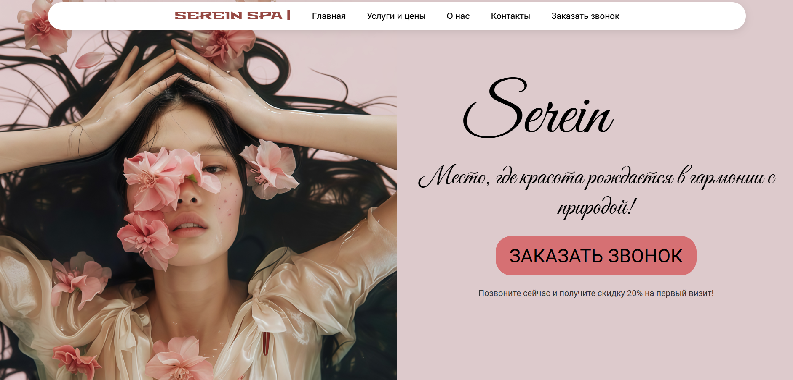

# Serein SPA

Учебный сайт СПА-салона с каталогом услуг и цен, страницей контактов и формой заказа обратного звонка.

- Интерфейс на Blade, CSS и JavaScript с адаптивной вёрсткой.
- Laravel проверяет данные формы и сохраняет заявки через Eloquent в таблицу `callbacks`.
- Форма проверяет формат белорусских номеров. Для тестовой заявки можно ввести `+375 (00) 000-00-00`. Приложение сохраняет заявку в базе. Отправка уведомлений и автоматические звонки не подключены.

## Скриншоты




## Локальный запуск

Понадобятся PHP 8.4.1 или новее в ветках 8.4 и 8.5, расширение `pdo_sqlite` и Composer 2. Для запуска страниц сборка фронтенда не нужна.

Выполните команды из корня репозитория. Для Windows используйте PowerShell.

```bash
composer install
php -r "file_exists('.env') || copy('.env.example', '.env');"
php artisan key:generate
php -r "file_exists('database/database.sqlite') || touch('database/database.sqlite');"
php artisan migrate
php artisan serve
```

Откройте `http://127.0.0.1:8000`.

## Структура проекта

- `routes/web.php` — маршруты страниц и формы.
- `resources/views/pages/` — главная, контакты и форма обратного звонка.
- `resources/views/layouts/` и `resources/views/partials/` — общий шаблон, навигация и подвал.
- `public/assets/` — стили страниц, изображения и скрипт формы.
- `app/Http/Controllers/CallbackController.php` и `app/Models/Callback.php` — обработка и хранение заявок.

## Тесты

```bash
php artisan test
```

Тесты формы проверяют сохранение заявки, отказ при неверном номере, отправку без JavaScript и ограничение частоты запросов. Тестовая база SQLite работает в памяти.
