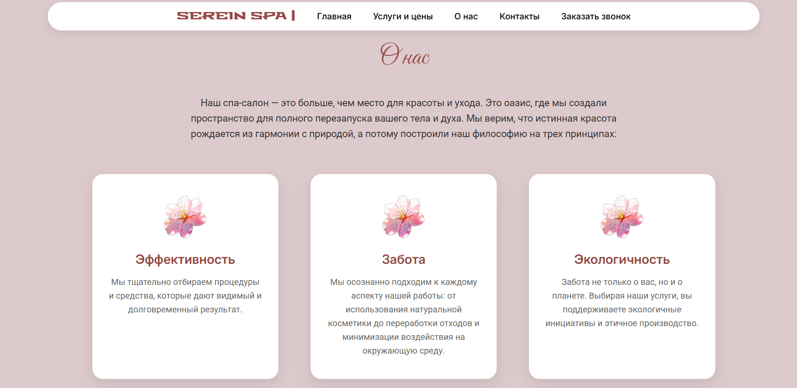
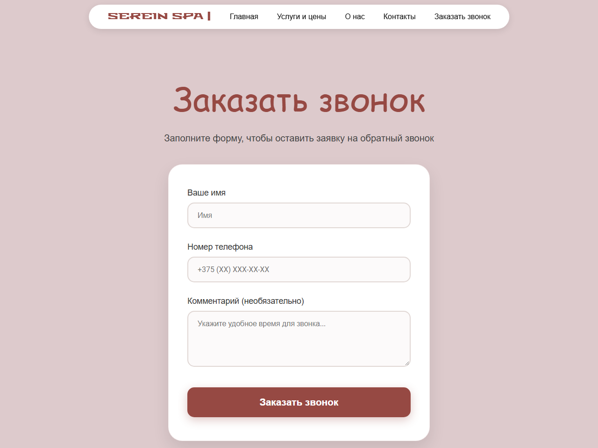

# Serein SPA

Serein SPA — сайт СПА-салона, на котором можно выбрать процедуру, узнать её длительность и стоимость и оставить заявку на обратный звонок.

## Цель проекта

Собрать информацию об услугах и условиях посещения в одном месте и дать посетителю возможность запросить звонок, чтобы уточнить детали процедуры или обсудить удобное время.

## Возможности

- **Каталог услуг.** Карточки процедур показывают длительность и стоимость.
- **Контакты.** На отдельной странице собраны адрес, телефон и часы работы салона.
- **Заказ обратного звонка.** Посетитель указывает имя и белорусский номер телефона, а при желании добавляет комментарий. Форма показывает ошибки рядом с полями и подтверждает приём заявки.
- **Обработка заявок.** Laravel проверяет данные на сервере, ограничивает частоту отправки и сохраняет принятые заявки в SQLite через Eloquent. Форма работает и при отключённом JavaScript.

**Стек** — Laravel, Blade, CSS, JavaScript и SQLite. Вёрстка адаптируется под ширину экрана.

## Скриншоты






## Предварительные требования

- PHP 8.4.1 или новее в ветках 8.4 и 8.5
- Расширение PHP `pdo_sqlite`
- Composer 2

## Запуск

Выполнить команды из корня репозитория. В Windows использовать PowerShell.

```bash
composer install
php -r "file_exists('.env') || copy('.env.example', '.env');"
php artisan key:generate
php -r "file_exists('database/database.sqlite') || touch('database/database.sqlite');"
php artisan migrate
php artisan serve
```

Открыть `http://127.0.0.1:8000`.

## Структура проекта

- `routes/web.php` — маршруты страниц и формы.
- `resources/views/pages/` — главная, контакты и форма обратного звонка.
- `resources/views/layouts/` и `resources/views/partials/` — общий шаблон, навигация и подвал.
- `public/assets/` — стили страниц, изображения и скрипт формы.
- `app/Http/Controllers/CallbackController.php` и `app/Models/Callback.php` — обработка и хранение заявок.

## Тесты

```bash
php artisan test
```

Тесты формы проверяют сохранение заявки, отказ при неверном номере, отправку без JavaScript и ограничение частоты запросов.
